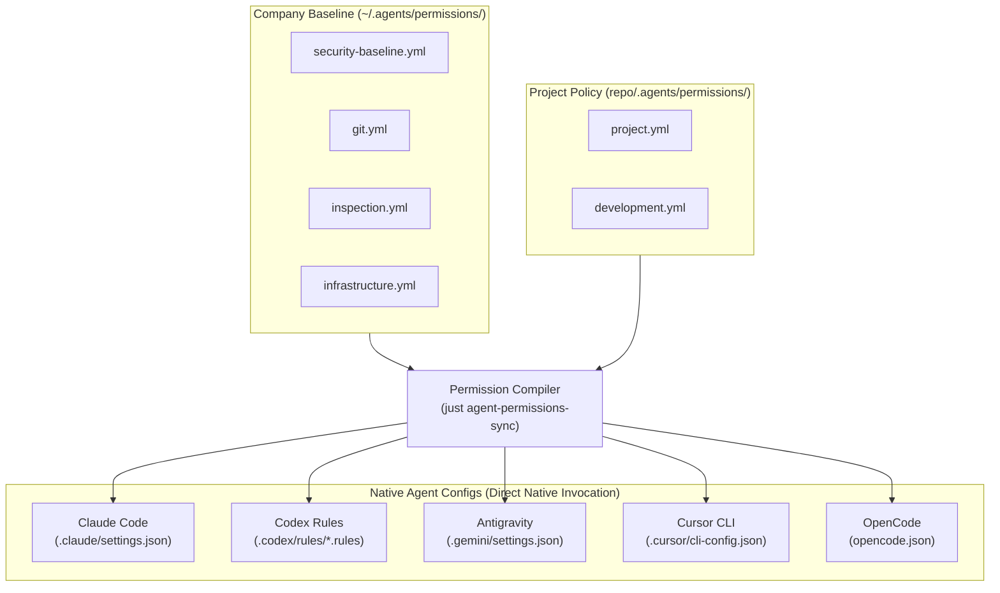
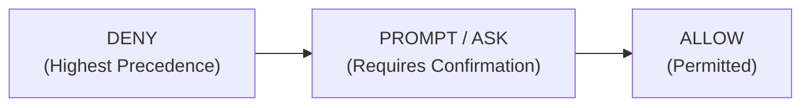

# Unified Coding-Agent Permissions

This directory contains the canonical command and tool permissions for AI coding agents operating in this repository.

## Architecture



Developers continue to invoke their native agent CLIs directly:

```bash
claude
codex
antigravity   # or agy
```

No runtime wrappers, proxies, or interceptors are used. Native agents enforce their native configuration files directly.

---

## 1. Source of Truth

The canonical permission configuration lives under `.agents/permissions/`.
- **Global / Company Baseline:** `~/.agents/permissions/*.yml`
- **Repository / Project Rules:** `<repo>/.agents/permissions/*.yml`

Dedicated generated permission files (e.g., `.codex/rules/generated-agents-policy.rules`, `.claude/settings.local.json`) are ignored in `.gitignore`. Whole agent directories are **never** ignored, and settings files are only gitignored if they contain solely generated permissions and no other configurations (such as hooks or MCP).

---

## 2. Policy Layering & Precedence

Permissions are structured in two layers:
1. **Company / User Baseline (`~/.agents/permissions/`):** Contains enterprise baseline rules, hard security boundaries, and universally permitted read-only inspection commands.
2. **Project Policy (`<repo>/.agents/permissions/`):** Supplements the organization baseline with commands specific to this repository.

### Precedence Model



- A project rule **cannot** weaken, override, or circumvent a baseline `deny`.
- If a project attempts to declare an `allow` rule for any command denied by the baseline (such as `sudo` or `rm -rf /`), the compiler fails loudly with a security violation error.
- At runtime, Codex's native `execpolicy` strictly resolves conflicting rules by selecting `forbidden` over `allow`. Claude Code and Antigravity likewise treat `deny` as overriding `allow`.

---

## 3. Policy Rules Summary

### Organization Baseline (`~/.agents/permissions/`)

- **Security Baseline (`security-baseline.yml`):**
  - **Deny (Hard Blocks):**
    - Privilege Escalation: `sudo`, `sudo:*`, `su`, `su:*`, `doas`, `doas:*`
    - System Power/State: `shutdown`, `shutdown:*`, `reboot`, `reboot:*`, `poweroff`, `poweroff:*`, `halt`, `halt:*`, `init:*`
    - Destructive Disk Tools: `dd`, `dd:*`, `mkfs`, `mkfs:*`, `fdisk`, `fdisk:*`, `parted`, `parted:*`
    - Catastrophic Deletion: `rm -rf /`, `rm -rf /*`, `rm -rf ~`, `rm -rf $HOME`
  - **Allow (Safe Environment Checks):** `pwd`, `whoami`, `id -u`, `id -un`, `date`, `uname`, `uname -a`, `which`
- **Git Read-Only (`git.yml`):**
  - **Allow:** `git status`, `git diff`, `git log`, `git show`, `git branch --show-current`, `git branch -a`, `git branch -v`, `git remote -v`, `git rev-parse HEAD`, `git rev-parse --show-toplevel`, `git tag -l`
- **File & Text Inspection (`inspection.yml`):**
  - **Allow:** `rg`, `grep`, `head`, `tail`, `jq`, `sort`, `uniq`, `wc`, `diff`

### Project Policy (`.agents/permissions/`)

- **Project Workflow (`project.yml`):**
  - **Allow:** `just agent-permissions-sync`, `just agent-permissions-check`, `just test`, `git add`, `git commit`, `git checkout`, `git restore`, `git stash`, `git stash list`, `git stash pop`
- **Development & Testing (`development.yml`):**
  - **Allow:** `node --test`, `npm test`, `npm run test`

---

## 4. How to Synchronize Permissions

To compile canonical permissions into vendor-native files:

```bash
just agent-permissions-sync
```

This command:
1. Validates all canonical `.yml` policies (syntax, supported tools, and safety constraints).
2. Verifies that no project rule weakens baseline denies.
3. Compiles Claude native configuration (`.claude/settings.json`).
4. Compiles Antigravity native configuration (`.gemini/settings.json`).
5. Generates Codex native execpolicy rules (`.codex/rules/generated-agents-policy.rules`).
6. Executes `codex execpolicy check` against the test matrix to verify behavior.

Synchronization is strictly **deterministic** and **idempotent**. Running the sync command repeatedly produces zero diff.

---

## 5. How to Validate, List & View Permissions

To verify permissions without mutating any files:

```bash
just agent-permissions-check
```

This command checks for configuration drift between `.agents/permissions/` and native generated files, returning exit code `0` if in sync and `1` if drift is detected.

To list all active permission sets across baseline and project scopes:

```bash
just agent-permissions-list
```

To view details and all allow/deny rules of a specific permission set:

```bash
just agent-permissions-view <set-name>
# Examples:
# just agent-permissions-view project
# just agent-permissions-view security-baseline
# just agent-permissions-view infrastructure
```

To run the automated policy test suite:

```bash
just test
```

---

## 6. Generated Native Files (Gitignored)

| Agent | Global Configuration Path | Project Configuration Path | Format |
|---|---|---|---|
| **Claude** | `~/.claude/settings.json` | `<repo>/.claude/settings.json` | JSON (`permissions.allow` / `permissions.deny`) |
| **Codex** | `~/.codex/rules/generated-agents-policy.rules` | `<repo>/.codex/rules/generated-agents-policy.rules` | Starlark (`prefix_rule`) |
| **Antigravity** | `~/.gemini/antigravity-cli/settings.json` | `<repo>/.gemini/settings.json` | JSON (`permissions.allow` / `permissions.deny`) |

### Preserved Files
- Existing user preferences in `~/.claude/settings.json` and `~/.gemini/antigravity-cli/settings.json` (such as themes, models, trusted workspaces) are preserved intact; only the `permissions` block is updated.
- Hand-maintained rule files such as `~/.codex/rules/default.rules` are **never overwritten**.
