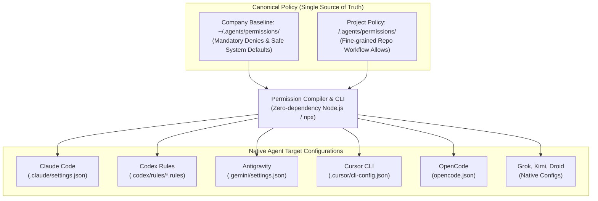
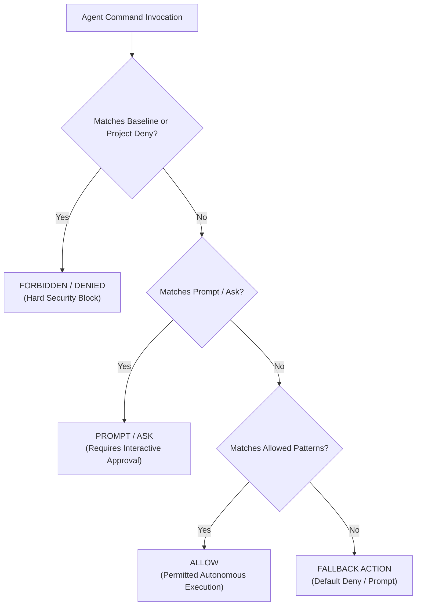

# Agent CLI Permissions (`agent-cli-permissions`)

A single, canonical permission configuration system and zero-dependency compiler for AI coding agents (`claude`, `codex`, `antigravity`, `cursor`, `opencode`, and more).

---

## The Problem We Are Solving

Modern software engineering teams increasingly empower autonomous AI coding agents (such as Anthropic Claude Code, OpenAI Codex CLI, Google Antigravity, Cursor, OpenCode, Grok, Kimi, and Factory Droid) to read files, run tests, and execute terminal commands.

However, granting agents shell access creates a critical security and operational dilemma:

### 1. The Security vs. Velocity Dilemma
* **If permissions are too loose (or unmanaged):** An agent can unintentionally execute destructive commands (`rm -rf /`, `dd`, `mkfs`), overwrite protected git branches, escalate root privileges (`sudo`, `su`, `doas`), or leak sensitive environment variables and credentials.
* **If permissions are too strict:** The agent halts to ask interactive user approval for every routine command (`git status`, `git diff`, `npm test`, `pwd`). This causes severe **prompt fatigue**, leading developers to disable safeguards entirely or configure reckless wildcard bypasses like `allow *` or `--dangerously-skip-permissions`.

### 2. Company Baseline vs. Project-Level Scope
Real-world engineering environments require **two tiers** of permission management:
* **Company / Global Level (`~/.agents/permissions/`):**
  Organizations require a non-negotiable security baseline across all machines. Security teams must enforce hard **DENY** boundaries—blocking privilege escalation, disk destruction, kernel tampering, and unvetted network exfiltration—regardless of which project a developer is working on.
* **Project Level (`<repo>/.agents/permissions/`):**
  Every project has a unique tech stack and workflow. A Node.js backend needs `npm test` and `node --test`; a Rust service needs `cargo test` and `cargo clippy`; a DevOps repository needs read-only `terraform validate` or `docker ps`. These permissions belong inside the repository so developers can work autonomously without modifying global security policies.

### 3. Absolute Security Precedence: `DENY > ASK > ALLOW`
A fundamental flaw of manual multi-agent configuration is configuration drift and policy weakening. `agent-cli-permissions` guarantees a mathematical security invariant:
> **Company Baseline `DENY` rules strictly override Project `ALLOW` rules.**
> If an organization baseline denies `sudo`, no project policy can ever allow `sudo`. The compiler detects policy weakening attempts and fails loudly at compile time.

### 4. Vendor Configuration Sprawl
Every agent vendor defines their own proprietary format and location for permissions:
* **Claude Code:** `.claude/settings.json` (`permissions.allow`, `permissions.deny`)
* **OpenAI Codex:** `.codex/rules/*.rules` (Starlark `prefix_rule(...)`)
* **Google Antigravity:** `.gemini/settings.json` (`permissions: { allow: [...], deny: [...] }`)
* **Cursor:** `.cursor/cli-config.json` (`permissions: [Shell(...)]`)
* **OpenCode:** `opencode.json` (`permission.bash: { pattern: action }`)
* **Grok, Kimi, Factory Droid, etc.**

Maintaining 8+ different proprietary configuration formats manually is error-prone and leads to configuration drift. `agent-cli-permissions` introduces **one canonical YAML format** (`.agents/permissions/*.yml`) that compiles deterministically into all vendor-native configurations with **zero runtime proxy overhead**.

---

## Architecture

Developers invoke native agent CLI binaries directly—with zero wrappers, runtime interceptor latency, or proxy daemons:



### Effective Evaluation Precedence

Rules are strictly evaluated in the order: **`DENY > PROMPT / ASK > ALLOW`**:



1. **Company Baseline Layering:** `~/.agents/permissions/` defines the perimeter. Project policies `<repo>/.agents/permissions/` specialize for local builds.
2. **Deny Precedence:** Baseline `deny` strictly takes precedence over project `allow`.
3. **Execution Guards:** Blanket wildcards for arbitrary execution tools (`bash`, `python`, `node`, `docker`, `curl`, `make`) are strictly rejected. Allowed rules must use specific subcommands or argument patterns (e.g., `git status:*`, `docker ps:*`, `npm test:*`).
4. **Direct Readers Registry:** Agents that natively support reading from `.agents/permissions/` directly are automatically skipped from redundant file generation (`AGENTS_READING_CANONICAL_DIRECTLY`).
5. **Selective Gitignoring:** Pure generated permission files are ignored in `.gitignore`, while files containing other configurations (such as MCP servers or session hooks) are preserved.

---

## Supported Native Agent Targets

| Agent | Global Config Path | Project Config Path | Generated Native Format |
| :--- | :--- | :--- | :--- |
| **Claude Code** | `~/.claude/settings.json` | `<repo>/.claude/settings.json` | JSON (`permissions.allow`, `permissions.deny`) |
| **OpenAI Codex** | `~/.codex/rules/generated-agents-policy.rules` | `<repo>/.codex/rules/generated-agents-policy.rules` | Starlark `prefix_rule(...)` |
| **Google Antigravity** | `~/.gemini/antigravity-cli/settings.json` | `<repo>/.gemini/settings.json` | JSON (`permissions: { allow: [...], deny: [...] }`) |
| **Cursor CLI** | `~/.cursor/cli-config.json` | `<repo>/.cursor/cli-config.json` | JSON (`permissions: [Shell(...)]`) |
| **OpenCode** | `~/.config/opencode/opencode.json` | `<repo>/opencode.json` | JSON (`permission.bash: { pattern: action }`) |
| **Grok** | `~/.grok/config.json` | `<repo>/.grok/config.json` | JSON (`permission.rules: [{ tool, pattern, action }]`) |
| **Kimi** | `~/.kimi-code/config.toml` | `<repo>/.kimi-code/config.toml` | TOML (`[permission] rules = [...]`) |
| **Factory Droid** | `~/.factory/settings.json` | `<repo>/.factory/settings.json` | JSON (`commandAllowlist`, `commandDenylist`) |

---

## Commands & Usage

`agent-cli-permissions` provides a zero-dependency CLI executable via **`npx`**, standard **`npm`** scripts, or directly via [`bin/agent-permissions`](file:///Users/cedric/Projects/AgenticCoding/permission-setup/bin/agent-permissions):

```bash
# Compile canonical YAML rules into all native agent configurations
npx agent-cli-permissions sync
# or: npx . sync, npm run sync, ./bin/agent-cli-permissions sync

# Verify zero drift between canonical rules and generated targets (CI mode)
npx agent-cli-permissions check
# or: npx . check, npm run check

# List all active permission sets across company baseline and project scopes
npx agent-cli-permissions list
# or: npx . list, npm run list

# View full allow/deny rules for a specific set
npx agent-cli-permissions view security-baseline
npx agent-cli-permissions view project

# Run the complete test suite (syntax, security guards, execpolicy assertions)
npx agent-cli-permissions test
# or: npm test

# Orca Plugin tasks
npx agent-cli-permissions orca check      # Build panel, validate manifest, run plugin tests
npx agent-cli-permissions orca install    # Build panel and install plugin into local Orca
```

---

## Project Structure

```text
agent-cli-permissions/
├── .agents/
│   └── permissions/            # Canonical YAML policy definitions
│       ├── development.yml     # Local dev test and verification rules
│       ├── project.yml         # Repository workflow permissions
│       └── README.md           # Policy format documentation
├── bin/
│   ├── agent-cli-permissions   # Executable CLI symlink
│   ├── agent-permissions       # Alias symlink
│   └── agent-permissions.mjs   # Standalone CLI entrypoint
├── src/
│   ├── lib/
│   │   ├── compilers.mjs       # Native generators for Codex, Claude, Antigravity, Cursor, etc.
│   │   ├── gitignore.mjs       # Safe .gitignore synchronizer (preserves MCP/hooks configs)
│   │   ├── parser.mjs          # Zero-dependency YAML and Tool(pattern) syntax parsers
│   │   └── validator.mjs       # Security guards, blanket executor checks, deny-precedence
│   ├── build-orca-panel.mjs    # Bundles the interactive Orca sidebar panel
│   └── sync-permissions.mjs    # Core synchronizer engine & Codex execpolicy verifier
├── orca-plugin/                # Native Orca IDE integration plugin
│   ├── orca-plugin.json        # Orca manifest (trusted-worker, 0 host capabilities)
│   ├── panel/index.html        # Interactive CLI permission evaluator panel
│   └── src/worker.ts           # Background worker executing sync commands
├── tests/
│   └── permissions.test.mjs    # Comprehensive Node.js native test suite
└── package.json                # Dual binary exports and npm script definitions
```

---

## License

[Apache-2.0](LICENSE)
