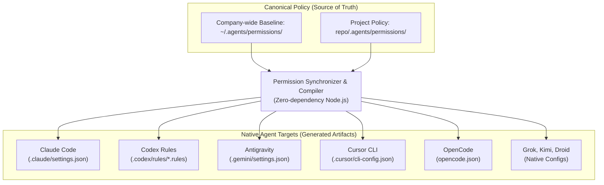
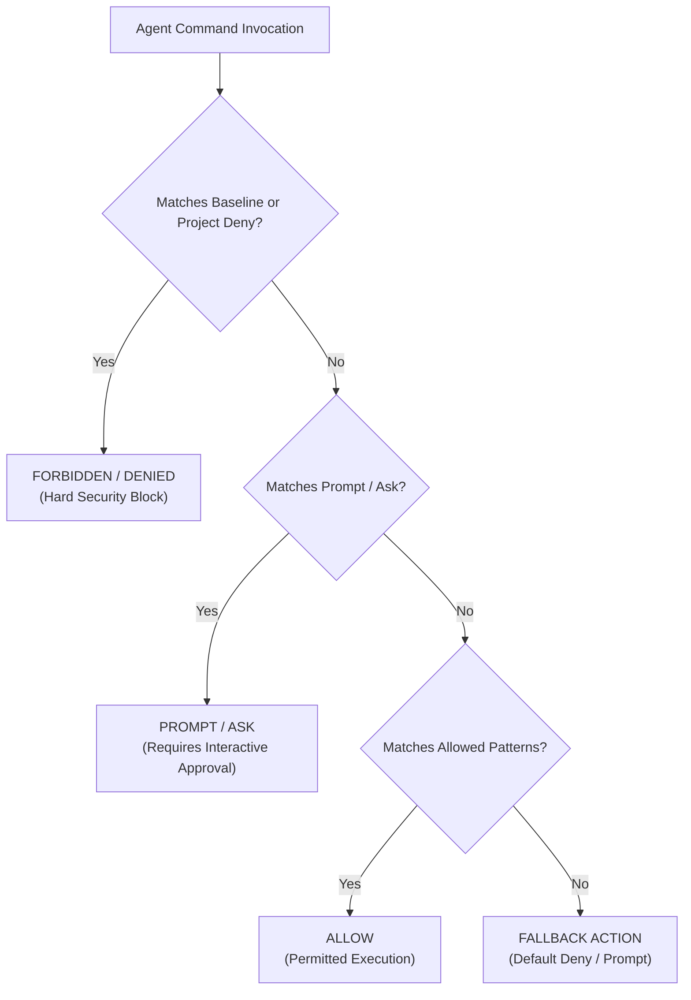

# Unified Coding-Agent Command Permissions

A single canonical permission configuration system for coding agents (`claude`, `codex`, `antigravity`, `cursor`, `opencode`, and more).

## Architecture

Developers run their native agent tools directly without wrappers or runtime proxies:



### Precedence & Evaluation

The effective policy evaluation strictly enforces `DENY > PROMPT/ASK > ALLOW`:



1. **Layering**: Organization baseline (`~/.agents/permissions/`) establishes the minimum security boundary. Project policy (`<repo>/.agents/permissions/`) extends baseline rules for repo-specific workflows.
2. **Precedence**: `DENY > PROMPT/ASK > ALLOW`. A project rule cannot weaken or contradict a mandatory deny from the baseline.
3. **Execution Guards**: Blanket allow for arbitrary executors (`bash`, `python`, `node`, `docker`, etc.) is strictly forbidden. Rules must use scoped subcommands and patterns (`git status:*`, `docker ps:*`).
4. **Direct .agents Readers**: If an agent natively supports reading from `.agents/permissions/` directly, no redundant native target file is compiled (`AGENTS_READING_CANONICAL_DIRECTLY` registry).

---

## Supported Native Agent Targets

| Agent | Config File (User / Global) | Config File (Project) | Native Format |
| :--- | :--- | :--- | :--- |
| **Claude** | `~/.claude/settings.json` | `<repo>/.claude/settings.json` | `permissions.allow`, `permissions.deny` |
| **Codex** | `~/.codex/rules/generated-agents-policy.rules` | `<repo>/.codex/rules/generated-agents-policy.rules` | Starlark `prefix_rule(...)` |
| **Antigravity** | `~/.gemini/antigravity-cli/settings.json` | `<repo>/.gemini/settings.json` | `permissions: [command(...)]` |
| **Cursor** | `~/.cursor/cli-config.json` | `<repo>/.cursor/cli-config.json` | `permissions: [Shell(...)]` |
| **OpenCode** | `~/.config/opencode/opencode.json` | `<repo>/opencode.json` | `permission.bash: { pattern: action }` |
| **Grok** | `~/.grok/config.json` | `<repo>/.grok/config.json` | `permission.rules: [{ tool, pattern, action }]` |
| **Kimi** | `~/.kimi-code/config.toml` | `<repo>/.kimi-code/config.toml` | TOML `[permission] rules = [...]` |
| **Droid** | `~/.factory/settings.json` | `<repo>/.factory/settings.json` | `commandAllowlist`, `commandDenylist` |

*(Note: Dedicated generated permission files like `.codex/rules/generated-agents-policy.rules` and `.claude/settings.local.json` are ignored in `.gitignore`. Whole agent directories (`.claude/`, `.codex/`, `.gemini/`) are never ignored so skills, commands, and custom rules remain trackable. Settings files are only gitignored if they contain solely permissions and no other configs like hooks or MCP.)*

---

## Commands

All commands are defined in [`justfile`](file:///Users/cedric/Projects/AgenticCoding/permission-setup/justfile):

```bash
# Synchronize canonical rules into all native agent formats
just agent-permissions-sync

# Verify zero drift between canonical rules and generated targets
just agent-permissions-check

# List all installed permission sets across baseline and project
just agent-permissions-list

# View full allow/deny rules for a specific set
just agent-permissions-view security-baseline
just agent-permissions-view project

# Run the complete test suite (syntax, security, execpolicy assertions)
just test
```

---

## Project Structure

```text
scripts/
├── lib/
│   ├── parser.mjs      # Zero-dependency YAML and canonical Tool(pattern) syntax parsers
│   ├── validator.mjs   # Security checks, blanket executor blacklist, directory loaders, deny-precedence
│   └── compilers.mjs   # Native target generators for Codex, Claude, Antigravity, Cursor, OpenCode, Grok, Kimi, Droid
└── sync-permissions.mjs # CLI entrypoint (sync, check, list, view), file I/O & Codex execpolicy runner
```
